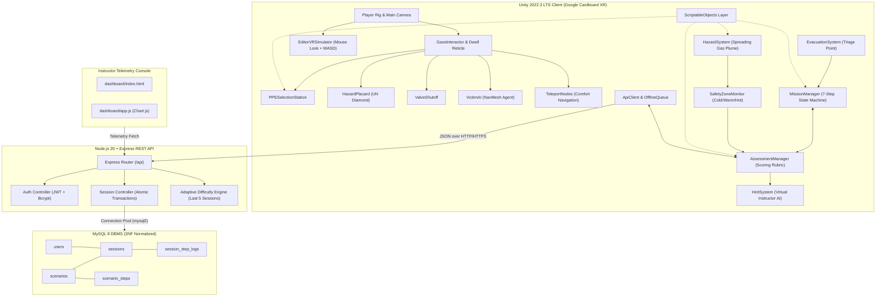
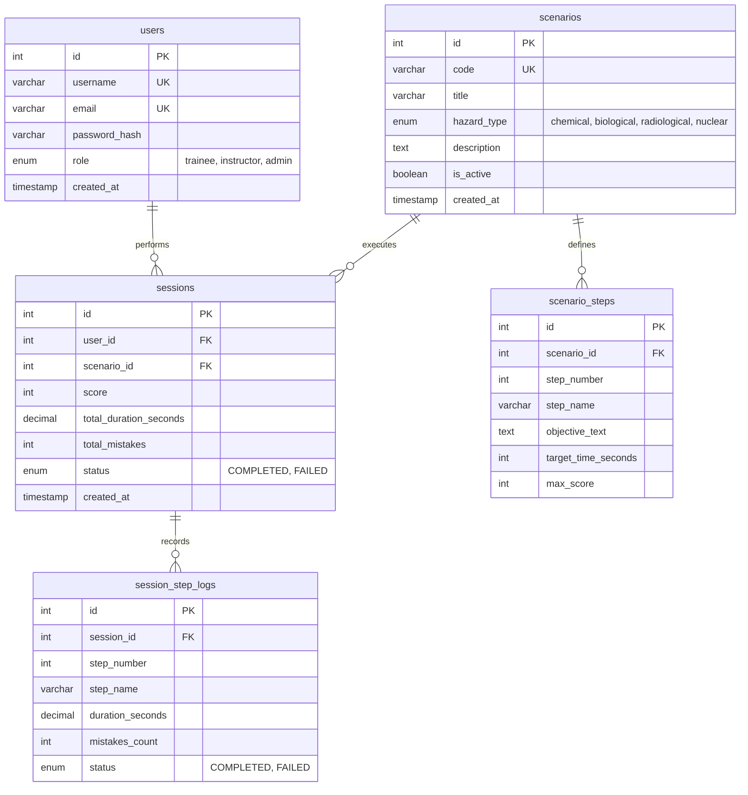
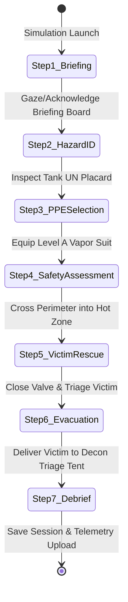

# CBRN-Trainer: Mobile VR Disaster Response Simulation

> **Academic Prototype Notice & Ethical Disclaimer:**  
> This project is an educational training prototype developed for academic coursework based on **Problem Statement 269 (Virtual Reality-Based Training for CBRN Disaster Response, Ministry of Home Affairs, for NDRF personnel)**. It is an educational prototype and **not an operational system**. Simulation scores and evaluations must **never** be presented or relied upon as proof of real-world qualification, certification, or operational readiness. All biological, radiological, and nuclear elements remain strictly at procedural level (isolation, shelter, evacuation, triage) with zero technical agent details and no real chemical-handling instructions.

---

## 1. Course Requirements Demonstrated

This repository demonstrates the three core requirements for the advanced software engineering and simulation curriculum:

| Requirement | Implementation in CBRN-Trainer | Key Source Files |
| :--- | :--- | :--- |
| **1. Mobile VR in Unity 3D** | Google Cardboard XR Plugin, stereo split-screen rendering, 3D depth-adjusted gaze reticle with 1.5s dwell timer, single-tap trigger, editor mouse-look simulation, and nausea-free teleport waypoints. | `GazeInteractor.cs`, `GazeReticle.cs`, `EditorVRSimulator.cs`, `TeleportNode.cs` |
| **2. AI inside VR Experience** | • **Casualty AI**: Finite State Machine (`Panic` $\rightarrow$ `Following` $\rightarrow$ `Safe`) navigating on baked NavMesh.<br>• **Hazard Spread System**: Expanding vapor cloud scaled by adaptive difficulty multiplier.<br>• **Virtual Instructor AI**: Context-aware guidance with dynamic corrective coaching on safety violations. | `VictimAI.cs`, `VictimState.cs`, `HazardSystem.cs`, `HintSystem.cs` |
| **3. Backend & DBMS Architecture** | Node.js 20 + Express REST API, JWT authentication, bcrypt hashing, single-transaction session & step-log recording, 3NF MySQL 8 schema with indexes & foreign keys, offline retry queue, and Chart.js instructor dashboard. | `server/schema.sql`, `server/src/`, `ApiClient.cs`, `OfflineQueue.cs`, `dashboard/` |

---

## 2. System Architecture



---

## 3. Database Design (3NF Normalization)

The database strictly conforms to **Third Normal Form (3NF)**:
- **1NF**: Atomic attributes, no repeating groups.
- **2NF**: All non-key attributes are fully functionally dependent on the primary key.
- **3NF**: No transitive dependencies (no non-key attribute depends on another non-key attribute).



---

## 4. Scenario State Machine & Procedural Steps

The core chemical disaster scenario executes across **7 distinct procedural steps**:



1. **Step 1 — Briefing**: Trainee reviews incident telemetry at the Cold Zone command billboard.
2. **Step 2 — Hazard Identification**: Trainee identifies the chemical threat using the UN hazmat placard (`UN 1005 Ammonia Analogue / Class 2.3`).
3. **Step 3 — PPE Selection**: Trainee selects the certified Level A vapor-protective ensemble from the donning locker. Selecting Level D or C triggers immediate instructional correction and point deduction.
4. **Step 4 — Safety Assessment**: Trainee crosses the buffer perimeter into the hazard area, verifying suit integrity and safe zone boundaries.
5. **Step 5 — Casualty Triage & Rescue**: Trainee isolates the ruptured valve wheel to halt plume expansion and calms the panicked casualty NPC.
6. **Step 6 — Evacuation**: Casualty follows trainee on the NavMesh into the Green Decontamination Triage Tent.
7. **Step 7 — Debrief & Score Evaluation**: On-screen performance report displays final score out of 100, mistake logs, and uploads session telemetry to the MySQL backend.

---

## 5. Quickstart Guide

### A. Unity VR Client Setup
1. Open **Unity Hub** -> **Add project from disk** -> Select `/Users/shloksharma/Desktop/CBRN`.
2. Ensure editor version is **Unity 2022.3 LTS**.
3. In Unity menu bar:
   - Click **CBRN** -> **1. Generate Scenario ScriptableObjects** (creates 12 data assets).
   - Click **CBRN** -> **2. Setup Complete Training Scene** (assembles full scene with all scripts wired).
4. Open **Window** -> **AI** -> **Navigation (Obsolete)** -> Click **Bake**.
5. Press **Play** to test in desktop simulator mode (Mouse look + WASD).

### B. Backend REST API Setup
1. Open terminal:
   ```bash
   cd /Users/shloksharma/Desktop/CBRN/server
   npm install
   ```
2. Initialize MySQL 8:
   ```bash
   mysql -u root -p < schema.sql
   mysql -u root -p < seed.sql
   ```
3. Launch server:
   ```bash
   npm start
   ```
   *Server listens on `http://localhost:3000`.*
4. Run Jest integration tests:
   ```bash
   npm test
   ```

### C. Instructor Dashboard
Open `/Users/shloksharma/Desktop/CBRN/dashboard/index.html` in any web browser to view trainee analytics, pass rates, mistake breakdowns, and adaptive difficulty status.

---

## 6. REST API Reference

| Method | Endpoint | Description | Auth Required |
| :--- | :--- | :--- | :---: |
| `POST` | `/api/auth/register` | Register new trainee/instructor account | No |
| `POST` | `/api/auth/login` | Authenticate user & receive JWT token | No |
| `GET` | `/api/scenarios` | List active CBRN scenarios | No |
| `GET` | `/api/scenarios/:id/steps` | List sequential steps for scenario | No |
| `POST` | `/api/sessions` | Atomic transaction: save session + step logs | Optional / Bearer |
| `GET` | `/api/sessions/user/:userId` | Trainee session history | Optional / Bearer |
| `GET` | `/api/sessions/leaderboard` | Top scoring trainees | No |
| `GET` | `/api/sessions/adaptive-difficulty/:userId` | Compute difficulty multiplier from last 5 sessions | No |
| `GET` | `/api/instructor/trainee-summary` | Aggregate analytics for instructor dashboard | Optional / Bearer |

---

## 7. Performance & Mobile VR Optimization Targets

- **Frame Rate Target**: 30+ FPS sustained on mid-range Android hardware.
- **Draw Calls**: Maintained under **40 batches** via static batching on all facility geometry.
- **Lighting**: Real-time hard shadows limited to 20m distance; no dynamic soft shadows.
- **Locomotion**: Discrete gaze-teleport waypoints eliminate vestibulo-ocular sensory conflict and motion sickness.
- **Fail-Safe Offline Mode**: `OfflineQueue.cs` caches session telemetry locally if network drops, ensuring zero data loss.

